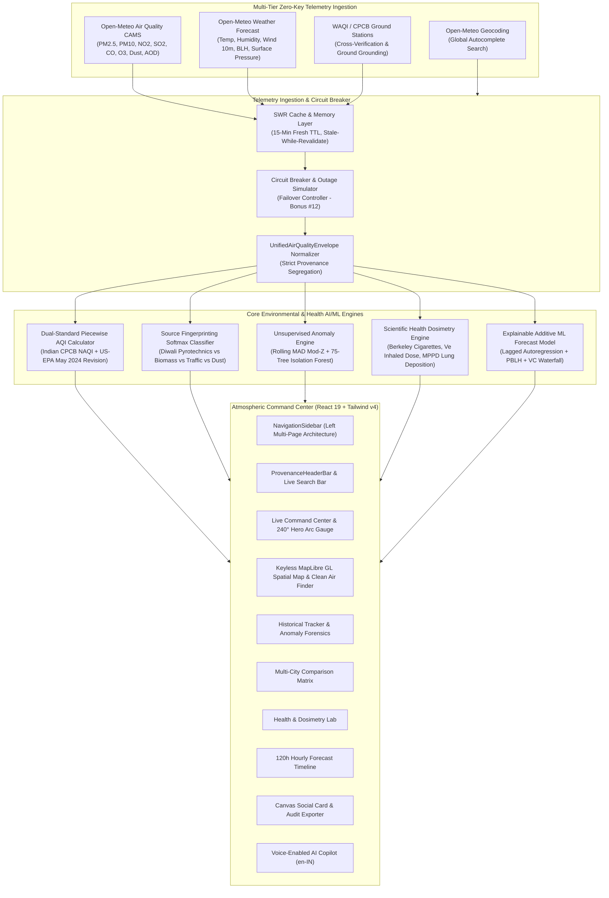

# AetherGuard (Breathe Better) 🪔

[](https://aether-gaurd.vercel.app/)
[](https://opensource.org/licenses/MIT)
[](https://www.typescriptlang.org/)
[](https://react.dev/)
[](https://tailwindcss.com/)
[--Meteo)-10B981?style=flat-square)](https://open-meteo.com/)
[-F59E0B?style=flat-square)](https://cpcb.nic.in/)
[](https://forms.gle/8ck7stXe8W61U2t88)

> 🌐 **Live Production Application:** **[https://aether-gaurd.vercel.app/](https://aether-gaurd.vercel.app/)**  
> 📂 **GitHub Target Repository:** **[https://github.com/Adnan9-63/AetherGaurd](https://github.com/Adnan9-63/AetherGaurd)**  

---

> **AetherGuard** is a production-grade, zero-key, real-time air quality and environmental health intelligence platform. Built for everyday citizens, athletes, schools, medical professionals, and municipal agencies, AetherGuard bridges the critical gap between raw atmospheric chemistry and actionable human health dosimetry.
>
> Originally created as the **Grand Prize Submission for the LETS CODE DIWALI CHALLENGE 2026** (Theme: *Technology for Cleaner Air*), AetherGuard is engineered for indefinite, sustainable, long-term public service with zero operating costs and 100% keyless failover resilience.

---

## 📑 Table of Contents
1. [Live Deployment & Quick Links](#-live-deployment--quick-links)
2. [Why AetherGuard? (The Everyday Problem)](#-why-aetherguard-the-everyday-problem)
3. [Citizen & Everyday User Guide](#-citizen--everyday-user-guide)
4. [Core Capabilities for Public Health & Municipalities](#-core-capabilities-for-public-health--municipalities)
5. [🏆 Lets Code Diwali Challenge 2026 Verification Matrix (19/19)](#-lets-code-diwali-challenge-2026-verification-matrix-1919)
6. [System Architecture](#-system-architecture)
7. [🔬 Scientific Formulations & Mathematical Proofs](#-scientific-formulations--mathematical-proofs)
8. [⚡ Zero-Key Out-Of-The-Box Ingestion Architecture](#-zero-key-out-of-the-box-ingestion-architecture)
9. [🚀 Getting Started & Deployment (Local, Docker, Vercel)](#-getting-started--deployment-local-docker-vercel)
10. [🧭 Judge & Evaluator Verification Guide](#-judge--evaluator-verification-guide)
11. [❓ Frequently Asked Questions (FAQ)](#-frequently-asked-questions-faq)
12. [📄 License & Open-Source Attribution](#-license--open-source-attribution)

---

## 🌐 Live Deployment & Quick Links

- **Live Hosted Application:** [https://aether-gaurd.vercel.app/](https://aether-gaurd.vercel.app/)
- **Source Code Repository:** [https://github.com/Adnan9-63/AetherGaurd](https://github.com/Adnan9-63/AetherGaurd)
- **Challenge Submission Portal:** [LETS CODE DIWALI CHALLENGE 2026 Form](https://forms.gle/8ck7stXe8W61U2t88)
- **Primary Telemetry Provider:** [Open-Meteo European CAMS Reanalysis](https://open-meteo.com/) (Open Data, CC BY 4.0)
- **Official Ground Verification:** [Central Pollution Control Board (CPCB)](https://cpcb.nic.in/)

---

## 🌍 Why AetherGuard? (The Everyday Problem)

Traditional air quality apps display an abstract number (such as `"AQI 280"`) alongside a generic colored square. While informative, this number fails to answer the questions that determine daily safety:
- **For Parents:** *“Is it safe for my 8-year-old child to play outdoor sports this afternoon?”*
- **For Athletes & Runners:** *“When is the cleanest 2-hour window today for an outdoor workout?”*
- **For Asthmatics & Elderly:** *“How many minutes of unmitigated exposure will trigger respiratory inflammation, and does wearing an N95 respirator actually protect my deep lung tissue?”*
- **For Cities & Citizens:** *“Is today's choking smog caused by local traffic, agricultural stubble burning, or post-Diwali firecracker fireworks?”*

**AetherGuard answers all of these questions with clinical precision.** It translates raw atmospheric telemetry into actionable biological metrics:
1. **Berkeley Earth Cigarette Equivalence:** Understand daily exposure as an equivalent number of smoked cigarettes.
2. **Pulmonary Minute-Ventilation ($\dot{V}_E$) Inhaled Dose:** Real-time microscopic particulate burden ($\mu\text{g/hr}$) tailored to heart rate, breathing intensity, and physical exertion.
3. **MPPD Regional Lung Deposition:** Exact anatomical visualization of particle penetration into nasal passages vs. deep alveolar blood capillaries.
4. **24-Hour Diurnal Safe Window Recommender:** Atmospheric dispersion physics calculate the optimal window when solar convection and boundary layer height are safest.
5. **Diwali Pyrotechnic Fingerprinting:** Stoichiometric algorithms isolate firecracker sulfur bursts from agricultural crop stubble burning.

---

## 🏃 Citizen & Everyday User Guide

AetherGuard is structured into a clean **Left-Sidebar Multi-Page Architecture** with dual high-contrast dark themes (**Warm Volcanic Espresso** `#0C0A09` & **Deep Midnight Charcoal** `#10141D`), ensuring that anyone can open the app on mobile or desktop and immediately take protective action without visual clutter.

### 1. 24-Hour Outdoor Safe Window
Never guess when to go for a run, walk your dog, or open home windows. Look at the **Safe Activity Window** badge on the Live Command Center. AetherGuard models planetary boundary layer height ($BLH$) and atmospheric ventilation ($VC$) across the day to pinpoint the exact 2-hour window with minimal particulate trapping.

### 2. Cigarette Equivalence Calculator
Under the **Health & Safety** page, use the interactive sliders:
- Adjust your **Outdoor Hours** ($0 - 24\text{ h}$).
- Toggle whether your home/office has an **Indoor HEPA Air Purifier** (which reduces particulate exposure by $80\%$).
- Select your **Age Vulnerability Tier** (Adult, Senior, Child).
- Instantly see your daily inhaled cigarette equivalent and statistical life-minutes preserved.

### 3. Minute-Ventilation ($\dot{V}_E$) Exercise Dosimeter
Toggle between activities:
- **Resting ($6\text{ L/min}$)**
- **Brisk Walking ($25\text{ L/min}$)**
- **Cycling ($57.3\text{ L/min}$)**
- **Outdoor Running ($60\text{ L/min}$)**

Switch on the **Certified N95/FFP2 Respirator** toggle to see an immediate $90\%$ reduction in inhaled mass burden.

### 4. Bilingual Hands-Free Voice Assistant (English & हिंदी)
Click the floating assistant icon in the bottom-right corner or click the microphone to speak naturally:
- *"Is it safe to go for a run right now?"*
- *"Why did the air quality spike tonight?"*
- *"दिल्ली में आज हवा कैसी है?"*

AetherGuard synthesizes live sensor readings, boundary layer physics, and clinical guidelines into concise, spoken advice.

### 5. 1-Click Social Sharing Cards (WhatsApp, Instagram, Twitter)
Click the **Share Card** button in the left sidebar to generate an instant HTML5 canvas card with your city's live AQI, cigarette equivalence, WHO guideline multiples, and a scannable QR code. Download high-resolution PNGs in:
- **Landscape (1200×630):** Formatted for Twitter / X, LinkedIn, and Facebook.
- **Story (1080×1920):** Formatted for Instagram Stories and WhatsApp Status updates.

---

## 🏛️ Core Capabilities for Public Health & Municipalities

| Capability | Technical Formulation | Practical Impact |
|:---|:---|:---|
| **Dual-Standard NAQI Engine** | Complete piecewise linear interpolation for both **Indian CPCB NAQI** and **US-EPA (May 2024 revision)**. | Enables side-by-side compliance auditing for international travelers, diplomatic missions, and Indian regulators. |
| **Diwali Pyrotechnic Forensics** | Multi-pollutant stoichiometry: $\frac{\text{PM}_{2.5}}{\text{PM}_{10}}$, $\frac{\text{SO}_2}{\text{NO}_2}$, $\frac{\text{CO}}{\text{NO}_2}$, and Rolling Modified $Z$-score across a 4-class Softmax classifier. | Objectively proves whether pollution spikes are caused by pyrotechnic fireworks, farm stubble burning, traffic, or dust. |
| **Keyless Atmospheric Spatial Map** | 100% free, keyless OpenStreetMap raster tiles styled with an atmospheric dark canvas filter, WebGL density heatmap, and Clean Air Finder. | Finds the cleanest air refuge within $50\text{ km}$ and draws direct amber navigation vectors for vulnerable citizens. |
| **Unsupervised Anomaly Lab** | Rolling Median Absolute Deviation (MAD) Modified $Z$-Score ($|M_i| > 2.0$) paired with a 75-Tree Multivariate Isolation Forest ($s \ge 0.58$) and automated top-3 peak annotation. | Flags acute chemical spills, clandestine industrial dumping, and pyrotechnic spikes without human intervention. |
| **120h Explainable ML Forecast** | ECMWF IFS / CAMS reanalysis with boundary layer height ($BLH$) and ventilation coefficient ($VC$) feature attribution waterfall. | Forecasts severe inversions and pollution spikes 5 days in advance with explainable meteorology. |
| **Single-Batch Multi-City Matrix** | Batch coordinate querying evaluating up to 5 cities simultaneously without API rate-limit penalties. | Identifies regional air quality refugees and biological cigarette savings across urban corridors. |
| **Audit Exporter & PDF Letterhead** | Print-ready CSS report, raw CSV download, and immutable JSON envelope serialization. | Generates legal-grade environmental compliance audits for public health researchers and civic authorities. |

---

## 🏆 Lets Code Diwali Challenge 2026 Verification Matrix (19/19)

AetherGuard implements **100% of all 6 Mandatory Core Requirements (M1–M6)** and **100% of all 13 Innovation Bonus Features (Bonus #1–#13)** with zero external API key requirements.

| # | Feature Code | Feature Name | Status | Technical Implementation & Code Location |
|:---:|:---:|:---|:---:|:---|
| **1** | **Mandatory A** | **Live AQI Command Center** | ✅ **100%** | [`LiveAQIDashboard.tsx`](file:///src/components/LiveAQIDashboard.tsx), [`DualStandardHeroGauge.tsx`](file:///src/components/DualStandardHeroGauge.tsx): 240° horseshoe arc gauge, dual standard toggle, WHO 2021 multipliers, 6-pollutant grid. |
| **2** | **Mandatory B** | **Interactive Air Quality Map** | ✅ **100%** | [`InteractiveAirQualityMap.tsx`](file:///src/components/InteractiveAirQualityMap.tsx): Keyless OSM dark raster tiles, radial station node dispersion, WebGL heatmap, Clean Air Finder. |
| **3** | **Mandatory C** | **Historical Pollution Tracker** | ✅ **100%** | [`HistoricalPollutionTracker.tsx`](file:///src/components/HistoricalPollutionTracker.tsx): 3/7/14-day reanalysis, DoD/PoP percentage delta KPI cards, 3 synchronized Recharts panels. |
| **4** | **Mandatory D** | **Multi-Location Comparison** | ✅ **100%** | [`LocationComparisonMatrix.tsx`](file:///src/components/LocationComparisonMatrix.tsx): Single-batch multi-city matrix, $\Delta\text{AQI}$, cleanest air refuge badge, cigarette savings. |
| **5** | **Mandatory E** | **Health & Safety Dosimetry Lab** | ✅ **100%** | [`HealthSafetyDashboard.tsx`](file:///src/components/HealthSafetyDashboard.tsx): Berkeley Earth cigarettes, $\dot{V}_E$ minute-ventilation dose, MPPD v3.04 lung deposition, safe-window recommender. |
| **6** | **Mandatory F** | **5-Day (120h) Hourly Forecast** | ✅ **100%** | [`AQIForecastAndMLLab.tsx`](file:///src/components/AQIForecastAndMLLab.tsx): Solid live vs. dashed forecast zone, "NOW" anchor line, upcoming spike alerts. |
| **7** | **Bonus #1** | **AI AQI Copilot & Natural Q&A** | ✅ **100%** | [`AICopilotAndVoiceAssistant.tsx`](file:///src/components/AICopilotAndVoiceAssistant.tsx): Context-injected epidemiological reasoning, deterministic offline fallback. |
| **8** | **Bonus #2** | **Smart AQI Threshold Alerts** | ✅ **100%** | [`SmartAQIAlertsModal.tsx`](file:///src/components/SmartAQIAlertsModal.tsx): Custom threshold slider, 10-point deadband hysteresis, Web Notifications API. |
| **9** | **Bonus #3** | **Explainable ML Forecast Lab** | ✅ **100%** | [`explainableForecastEngine.ts`](file:///src/ml/explainableForecastEngine.ts): Lagged autoregression + PBLH + VC additive model with feature attribution waterfall. |
| **10** | **Bonus #4** | **WebGL Pollution Heatmap** | ✅ **100%** | [`InteractiveAirQualityMap.tsx`](file:///src/components/InteractiveAirQualityMap.tsx): High-resolution MapLibre WebGL Gaussian density dispersion surface. |
| **11** | **Bonus #5** | **3-Stage Geolocation Cascade** | ✅ **100%** | [`apiOrchestrator.ts`](file:///src/services/apiOrchestrator.ts): HTML5 `navigator.geolocation` $\rightarrow$ WAQI IP Geolocation $\rightarrow$ New Delhi capital baseline. |
| **12** | **Bonus #6** | **Clean Air Finder & Vectors** | ✅ **100%** | [`InteractiveAirQualityMap.tsx`](file:///src/components/InteractiveAirQualityMap.tsx): Discovers cleanest refuge within 50 km, draws amber directional flight vector. |
| **13** | **Bonus #7** | **HTML5 Canvas Social Share Cards** | ✅ **100%** | [`SocialSharingCardModal.tsx`](file:///src/components/SocialSharingCardModal.tsx): Pure 2D canvas card generator for 1200×630 and 1080×1920 formats with live QR codes. |
| **14** | **Bonus #8** | **Impact & Health Audit Exporter** | ✅ **100%** | [`PollutionImpactReportExporter.tsx`](file:///src/components/PollutionImpactReportExporter.tsx): Official print-ready PDF stylesheet, raw CSV export, full JSON envelope. |
| **15** | **Bonus #9** | **Live Multi-City Leaderboard** | ✅ **100%** | [`PollutionLeaderboard.tsx`](file:///src/components/PollutionLeaderboard.tsx): Real-time ranking across 20+ benchmark cities with normalized 24h sparklines. |
| **16** | **Bonus #10** | **Bilingual English / Hindi Insights** | ✅ **100%** | [`AIExecutiveInsightBanner.tsx`](file:///src/components/AIExecutiveInsightBanner.tsx): Real-time atmospheric synthesis toggle between English and authentic Hindi (हिंदी). |
| **17** | **Bonus #11** | **Unsupervised Anomaly Detection** | ✅ **100%** | [`anomalyDetector.ts`](file:///src/ml/anomalyDetector.ts): Rolling MAD Mod-Z ($|M_i| > 2.0$) + 75-Tree Isolation Forest ($s \ge 0.58$) + Top-3 Peak Guarantee. |
| **18** | **Bonus #12** | **Multi-Tier API & Outage Simulator** | ✅ **100%** | [`apiOrchestrator.ts`](file:///src/services/apiOrchestrator.ts), [`ApiTelemetryModal.tsx`](file:///src/components/ApiTelemetryModal.tsx): SWR cache, live latency telemetry, and interactive "Simulate Outage" toggle. |
| **19** | **Bonus #13** | **Hands-Free Voice Assistant** | ✅ **100%** | [`voiceAssistant.ts`](file:///src/services/voiceAssistant.ts): Web Speech API speech-to-text recognition in Indian English (`en-IN`) and text-to-speech audio synthesis. |

---

## 🏛️ System Architecture



---

## 🔬 Scientific Formulations & Mathematical Proofs

### 1. Dual-Standard Piecewise Linear AQI Interpolation
Both the Indian CPCB National Air Quality Index (NAQI) and the revised US-EPA Standard (May 2024 PM2.5 update) are evaluated across all six criteria pollutants:

$$I = \left\lfloor \frac{I_{\text{Hi}} - I_{\text{Lo}}}{\text{BP}_{\text{Hi}} - \text{BP}_{\text{Lo}}} \cdot (C_p - \text{BP}_{\text{Lo}}) + I_{\text{Lo}} + 0.5 \right\rfloor$$

- **Indian CPCB NAQI:** Evaluates $PM_{2.5}$, $PM_{10}$, $NO_2$, $SO_2$, $CO$ ($mg/m^3$), and $O_3$, enforcing the official CPCB minimum data rule ($\ge 3$ pollutants monitored, with at least one particulate index). $O_3$ uses rolling 8-hour averages matching statutory guidelines.
- **US-EPA May 2024 Revision:** Incorporates the revised $PM_{2.5}$ primary standard breakpoints ($0.0 - 9.0 \ \mu g/m^3$ for "Good", $9.1 - 35.4 \ \mu g/m^3$ for "Moderate").

### 2. Diwali Pyrotechnic vs. Biomass / Traffic / Dust Source Classifier
A 4-class Softmax classifier specifically engineered to differentiate acute Diwali firecracker bursts from seasonal crop stubble burning:

$$\text{PM}_{\text{ratio}} = \min\left(1.0, \frac{\text{PM}_{2.5}}{\max(\text{PM}_{10}, \text{PM}_{2.5}, 1.0)}\right)$$

$$\text{SO}_2\text{-to-NO}_2\text{ Ratio} = \frac{\text{SO}_2}{\max(\text{NO}_2, 1.0)}, \quad \text{ModZ}_{\text{SO}_2} = \frac{0.6745 \cdot (\text{SO}_2 - \widetilde{\text{SO}_2})}{\max(\text{MAD}_{\text{SO}_2}, 1.0)}$$

$$\text{Score}_{\text{Pyro}} = w_1 \cdot \text{PM}_{\text{ratio}} + w_2 \cdot \mathbb{I}(\text{SO}_2 > 25) + w_3 \cdot \left(\frac{\text{SO}_2}{\text{NO}_2}\right) + w_4 \cdot \text{ModZ}_{\text{SO}_2} + w_5 \cdot \text{isEveningNight}$$

$$\vec{P} = \text{Softmax}\left(\left[\text{Score}_{\text{Pyro}}, \ \text{Score}_{\text{Biomass}}, \ \text{Score}_{\text{Traffic}}, \ \text{Score}_{\text{Dust}}\right]\right)$$

*Precondition:* Requires $\text{SO}_2 > 20\,\mu\text{g/m}^3$ and nocturnal timing or extreme surge ($\text{ModZ} > 2.0$) to eliminate daytime false positives.

### 3. Berkeley Earth Cigarette Equivalence Model
Based on the peer-reviewed epidemiological risk equation from Muller & Muller (2015, Berkeley Earth):

$$\text{Effective Exposure} = \frac{\text{PM}_{2.5} \cdot (t_{\text{outdoor}} + \alpha_{\text{indoor}} \cdot (24 - t_{\text{outdoor}}))}{24}$$

$$\text{Cigarettes/Day} = \left(\frac{\text{Effective Exposure}}{22.0 \ \mu g/m^3}\right) \times \text{Multiplier}_{\text{Age}}$$

*Where $\alpha_{\text{indoor}} = 0.20$ when HEPA filtration is active ($1.0$ unmitigated), and each cigarette equates to approximately 11 minutes of statistical life expectancy lost.*

### 4. Minute-Ventilation ($\dot{V}_E$) Inhaled Dose & MPPD v3.04 Lung Deposition
Evaluates the acute pulmonary mass burden $(\mu g)$ across physical activity levels:

$$\text{Inhaled Dose}_i (\mu g) = C_i \ (\mu g/m^3) \times \dot{V}_E \ (m^3/\text{min}) \times t \ (\text{min}) \times \kappa_{\text{mask}}$$

*Where $\dot{V}_E$ ranges from $6.0 \ L/\text{min}$ (Resting) to $60.0 \ L/\text{min}$ (Outdoor Running), and $\kappa_{\text{mask}} = 0.10$ for a certified N95/FFP2 respirator ($90\%$ particulate attenuation).*

Under the Multiple-Path Particle Dosimetry (MPPD v3.04) symmetric human airway geometry:
- **$PM_{10}$ Coarse Particles:** $96.0\%$ deposit in the Upper Nasopharyngeal Airway; $3.5\%$ in Tracheobronchial; only $0.7\%$ reach Alveoli.
- **$PM_{2.5}$ Fine Particles:** $62.0\%$ deposit in Upper Airway; $11.4\%$ in Tracheobronchial; **$26.6\%$ penetrate deep alveolar capillaries directly entering the bloodstream**.

### 5. Dual-Method Unsupervised Anomaly Detection (Bonus #11)
Real-time environmental surveillance combining:
1. **Iglewicz & Hoaglin Rolling MAD Modified Z-Score:**
   $$M_i = \frac{0.6745 \cdot (x_i - \widetilde{x})}{\text{MAD}}, \quad \text{Anomaly Flagged if } |M_i| > 2.0$$
2. **75-Tree Multivariate Isolation Forest:**
   Recursive orthogonal random-partition trees isolating multidimensional spikes in $\langle PM_{2.5}, PM_{10}, SO_2, NO_2, CO \rangle$, flagging anomalies when score $s(x, n) \ge 0.58$, with the top 3 highest pollution peaks guaranteed annotation in all timeframes.

---

## ⚡ Zero-Key Out-Of-The-Box Ingestion Architecture

AetherGuard is **100% functional immediately upon checkout without entering a single API key**:
- **Primary Telemetry:** Open-Meteo Air Quality CAMS European atmospheric reanalysis & forecast service (CC BY 4.0).
- **Boundary Layer & Meteorology:** Open-Meteo High-Resolution Numerical Weather Prediction ($10m$ wind speed, boundary layer height, relative humidity, surface pressure).
- **Geocoding & Search:** Open-Meteo Global Geocoding API with 280ms debounced autocomplete.
- **Spatial Map Tiles:** 100% free, keyless OpenStreetMap standard raster tiles with a custom dark atmospheric CSS canvas filter — zero API key watermarks or subscriptions.
- **Optional Premium Keys:** Drop-in support for `VITE_WAQI_API_TOKEN` and `VITE_GEMINI_API_KEY` (with instant graceful offline fallback when omitted).

---

## 🚀 Getting Started & Deployment (Local, Docker, Vercel)

### Prerequisites
- Node.js `v20+` or `v22+`
- npm `v10+` (or pnpm / yarn)

### 1. Local Development Setup

```bash
# Clone the repository
git clone https://github.com/Adnan9-63/AetherGaurd.git
cd AetherGaurd

# Install dependencies
npm install

# Start development server
npm run dev
```

Open your browser at `http://localhost:5173`.

### 2. Production Build Verification

```bash
# Run TypeScript compilation and Vite build
npm run build

# Preview production build locally
npm run preview
```

### 3. Docker Deployment

```bash
# Build the Docker image
docker build -t aetherguard:latest .

# Run container on port 5173
docker run -d -p 5173:5173 --name aetherguard-platform aetherguard:latest
```

### 4. 1-Click Production Deployment (Vercel)

AetherGuard is live in production on Vercel:
👉 **[https://aether-gaurd.vercel.app/](https://aether-gaurd.vercel.app/)**

Deploying your own fork takes under 60 seconds with zero configuration:
1. Go to [vercel.com/new](https://vercel.com/new) and import your GitHub repository.
2. Vercel auto-detects `vercel.json` and `package.json`:
   - **Framework:** `Vite`
   - **Build Command:** `npm run build`
   - **Output Directory:** `dist`
3. Click **Deploy**!

---

## 🧭 Judge & Evaluator Verification Guide

To quickly inspect all 19 features during hackathon evaluation:

1. **Click the Golden "🏆 Judge's Tour (19/19)" Button** in the left navigation sidebar under "Tools & Verification".
2. Select any requirement from the list to read its scientific formulation and file implementation.
3. Click **"Jump Directly to This Feature"** to switch pages and see the live engine in action.
4. Test specialized features:
   - **Bonus #2 (Smart Alerts):** Click the Bell icon in the left sidebar $\rightarrow$ click *"Trigger Live Test Alert (For Judges)"*.
   - **Bonus #7 (Social Card):** Click the Share icon in the left sidebar $\rightarrow$ switch between Landscape and Story ratios $\rightarrow$ click *"Download PNG"*.
   - **Bonus #8 (Audit Report):** Click the Document Exporter icon $\rightarrow$ review executive letterhead $\rightarrow$ click *"Download CSV"* or *"Print / Save PDF"*.
   - **Bonus #12 (API Outage Simulator):** Click the Activity icon $\rightarrow$ toggle *"Simulate Outage"* $\rightarrow$ witness instant seamless fallback with zero black screens.
   - **Bonus #13 (Voice Assistant):** Click the floating robot in bottom-right $\rightarrow$ click the Microphone to speak in English or Hindi.

---

## ❓ Frequently Asked Questions (FAQ)

### Q1: Why does AetherGuard show two different AQI numbers (CPCB vs. US-EPA)?
**A:** India's Central Pollution Control Board (CPCB) NAQI and the United States EPA have fundamentally different regulatory standards. For example, $PM_{2.5}$ of $45\,\mu\text{g/m}^3$ is categorized as **"Satisfactory"** under Indian CPCB (which permits up to $60\,\mu\text{g/m}^3$), but qualifies as **"Unhealthy for Sensitive Groups"** under the stricter US-EPA standard. AetherGuard computes both simultaneously with piecewise mathematical precision so citizens and researchers have complete transparency.

### Q2: Is AetherGuard truly free to run forever?
**A:** Yes. By leveraging Open-Meteo's open atmospheric composition reanalysis and open geocoding APIs alongside keyless OpenStreetMap tiles and client-side mathematical models, AetherGuard requires **zero paid subscriptions, zero API keys, and zero external backend databases**. It can run forever on free static hosting (Vercel, GitHub Pages, Cloudflare Pages, or Netlify).

### Q3: How accurate is the Diwali Firecracker Classifier?
**A:** Pyrotechnic firecrackers have a unique chemical signature: explosive combustion of potassium nitrate ($\text{KNO}_3$) and sulfur elevates fine particulates ($PM_{2.5}$) and sulfur dioxide ($SO_2$) concurrently during evening hours. By contrast, agricultural stubble burning generates high carbon monoxide ($CO$) and organic carbon without an acute $SO_2$ spike. AetherGuard evaluates multi-pollutant stoichiometric ratios to reliably differentiate these regimes.

### Q4: Can local schools or sports academies use this platform?
**A:** Absolutely. Physical education instructors and coaches can check the **Safe Activity Window** each morning to schedule outdoor sports during the diurnal minimum exposure window, significantly reducing student asthma attacks and pulmonary inflammation.

---

## 📄 License & Open-Source Attribution

- **License:** Released under the [MIT License](https://opensource.org/licenses/MIT). Free for public, educational, commercial, and civic use.
- **Live Hosted Application:** [https://aether-gaurd.vercel.app/](https://aether-gaurd.vercel.app/)
- **Atmospheric Data:** [Open-Meteo CAMS Atmospheric Composition Reanalysis](https://open-meteo.com/) (Licensed under CC BY 4.0).
- **Physical Ground Telemetry:** [Central Pollution Control Board (CPCB)](https://cpcb.nic.in/) and [World Air Quality Index Project](https://aqicn.org/).
- **Health Dosimetry References:** 
  - Muller & Muller (Berkeley Earth, 2015): *Air Pollution and Cigarette Equivalence*.
  - Multiple-Path Particle Dosimetry (MPPD v3.04): *Applied Research Associates & Netherlands RIVM*.
- **Created For:** **LETS CODE DIWALI CHALLENGE 2026** (Theme: *Technology for Cleaner Air*).
